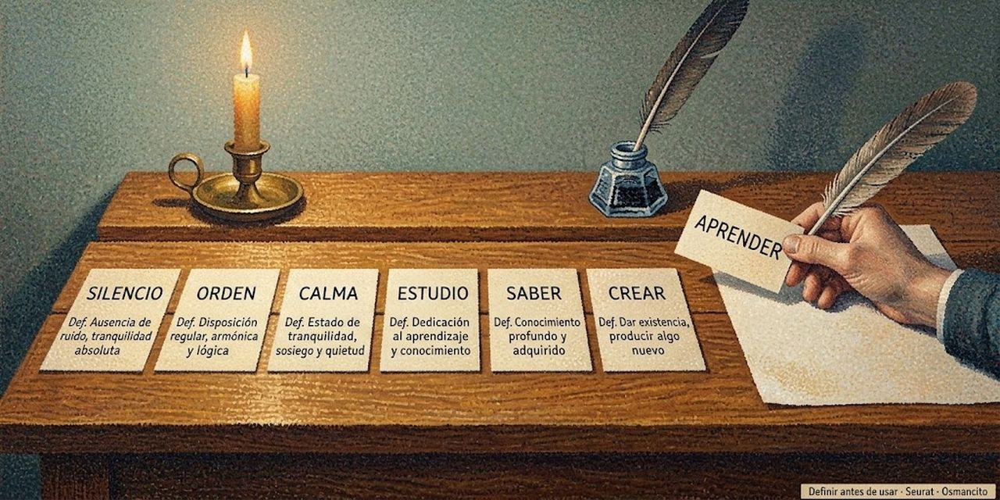

22 de octubre de 2026

# Alambique - Escritura Cero

Escritura Cero es la manera de escribir un texto de modo que una persona o una máquina lo entienda sin haber leído nada más.

## 1. Palabras primitivas

Este texto usa las palabras comunes del idioma con su significado de diccionario, desde su primera frase. Esas palabras se llaman primitivas. Toda palabra que no sea primitiva se define en este texto.

## 2. Definiciones

- **Término:** palabra o expresión que este texto define.
- **Definición:** frase que dice qué significa un término, con palabras primitivas y con términos definidos antes.
- **Uso:** aparición de un término fuera de su definición.
- **Enunciado:** frase completa que dice algo.
- **Lector cero:** persona o máquina que lee un texto sin haber leído nada más.

## 3. Reglas

- **R1. Definir antes de usar.** Todo término se define antes de su primer uso.
- **R2. Todo dentro.** El texto no remite a otro archivo, página o documento para entender un término.
- **R3. Un término, un significado.** Cada término tiene una sola definición.
- **R4. Un nombre por cosa.** Cada cosa tiene un solo término.
- **R5. Sin circularidad.** Una definición no usa el término que define ni un término definido después.
- **R6. Sin supuestos.** Todo lo necesario para entender un enunciado está en el texto o es una palabra primitiva.
- **R7. Una idea por enunciado.** Cada enunciado dice una sola cosa.
- **R8. Orden.** Un enunciado no remite a nada que el texto diga después.
- **R9. Sin adornos de método.** El texto no lleva etiquetas sobre su propio proceso o su origen que el lector cero no necesite.

## 4. Alcance y comprobación

Estas reglas rigen todo texto escrito para el lector cero. No fijan estilo ni tono. Un texto está escrito con Escritura Cero si cumple las reglas R1 a R9. Para comprobar R1, R3 y R4, se puede señalar, para cada término, su definición, que esa definición va antes de su primer uso y que su significado no cambia.

© 2026 Osmancito
