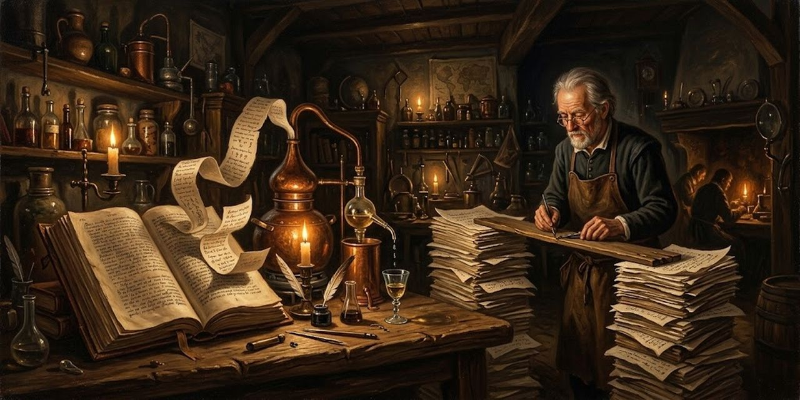

14 de octubre de 2026

# El procedimiento de la Destilería

Destilar una obra es quitarle lo que sobra hasta que cabe en la mano y se puede contar. Este cuaderno reúne el procedimiento completo, de la obra entera al destilado, en el orden en que se hace.

## 1. Partir en frases

La obra se parte en frases. Cada una guarda un identificador y su origen: la escena, el cuento, el capítulo. Todo lo que sigue se refiere a las frases por su identificador, y nada se escribe sin poder volver a la frase de donde viene.

## 2. Medir

Antes de leer se mide, con una regla que no sabe de literatura. Un motor de embeddings lee una frase y devuelve una lista larga de números: su dirección en un mapa de significados. Las frases que hablan de lo mismo caen cerca, aunque no compartan una palabra; las que no tienen relación caen lejos.

Se compara qué motor agrupa mejor las frases por escena o capítulo, y se elige el que mejor separa la obra. Las diferencias suelen ser pequeñas y ninguno acierta de sobra, porque una obra se deja separar mal.

Otros criterios acompañan a los vectores, cada uno con su límite:

- **Mapa de densidad:** el peso de cada palabra como sorpresa dentro de la propia obra, según la teoría de la información. Mide rareza, no sentido.
- **Eco del autor:** las frases que el texto retoma y replantea.
- **Enlaces estructurales:** personajes que coinciden en escena, ecos entre escenas.

Rige una regla: afuera del corpus no existe. Las frecuencias se calculan dentro de la obra, y todo modelo declara qué trae de fuera.

## 3. Mapear

Un mapa se arma de dos maneras. Se **capta** lo que el mundo ya marcó como famoso, como una lista de frases célebres de la obra. O se **construye** lo que el corpus muestra de sí mismo, y de ahí sale el mapa mecánico, en tres pasadas:

- **PCA** deja unos cincuenta ejes y suelta el ruido.
- **UMAP** baja esos ejes a dos o tres, cuidando que los vecinos sigan siéndolo.
- **HDBSCAN** marca las zonas densas sin que nadie diga cuántas buscar; las frases sueltas se declaran sueltas.

La **nube de cercanía** apoya al ojo: cada frase es un punto, y su color dice qué tan cerca está del centro, que es el promedio de toda la obra. Pero manda la **lista de cercanía**, las frases ordenadas de la más cercana a la más lejana. La cercanía se normaliza por motor: compara frases dentro de un motor, no entre motores. El método actúa sobre zonas de esa lista, no sobre posiciones sueltas.

El mapa enseña dónde mirar y no dicta nada. Una isla es una pista, no una prueba.

## 4. Elegir los tramos

Sobre el mapa se eligen tramos: frases seguidas, indicadas por identificador, que son texto literal de la obra. Una medida que pretenda predecir qué merece quedarse debe superar controles baratos, como el azar, la longitud, la posición y la rareza. Quien mide, quien destila y quien evalúa no deben ser el mismo, porque si no la prueba es circular.

Una frase dudosa no se presenta desnuda: llega con su glosa, porque nadie decide lo que no entiende. Entra o sale con la glosa puesta, y la glosa informa dos veces. Por su peso: la frase que necesita tres líneas de rescate para sostenerse ya está confesando. Por lo que revela: explicada, la frase tiene que dejar algo de valor para el lector, y si la glosa solo aclara y no deja nada, la frase no tiene por qué estar.

## 5. Destilar

Un destilado no es un resumen: es el mismo texto con menos agua, como el demi-glace, que se reduce a fuego lento, decantando y probando. Pedir la mitad de golpe devuelve bastante más de la mitad. Repetir el pedido con calma sobre lo ya devuelto reduce más, hasta que la máquina se detiene sola. Cortar poco y repetir llega más lejos que cortar de golpe.

La cata es una lista de frases famosas de la obra: se cuenta cuántas sobreviven en el destilado frente a la parte del texto que se conservó. Lo que queda es palabra por palabra del original, en su orden. El pliegue corta y no reescribe.

## 6. Tender puentes

Entre dos tramos faltan frases, y el lector que llega de cero no debe quedar perdido. El criterio: la prosa de Instinct solo entra donde el original no puede llegar. Tiene tres usos:

- **Costura:** une dos bloques cuando ninguna frase del texto puede hacer la transición.
- **Glosa:** da el contexto que el original supone y el invitado no tiene, como quién es un personaje o un nombre propio.
- **Marco:** abre la pieza y la orienta.

Y una prohibición: nunca se parafrasea lo que el texto ya dice. Si la frase existe, se cita.

El destilado se arma con un plan de puentes y unión que incluye frase y glosa escuela en proporción 1:1: por cada palabra de prosa propia, una de frase del original.

La **medida honesta** cuenta como propias solo las palabras que no tienen un original detrás. Una paráfrasis de una frase existente no es voz propia, es el original con otra letra, y debe volver a la suya.

## 7. Verificar

Con la obra abierta, nunca de memoria. Cada frase citada se busca literal en el original. Cada puente se relee como lo leería un invitado: ¿sabe quién habla, a quién y dónde? Lo confuso señala el lugar. Por último se mide con la medida honesta que la prosa propia y las frases citadas estén en proporción 1:1.

## Límites

Un embedding refleja lo que su modelo aprendió, y otro modelo daría otro mapa parecido, no idéntico. Aplanar pierde información por definición. La medida ayuda a decidir; la lectura sigue siendo de quien lee.

Osmancito, con la asistencia de Instinct
