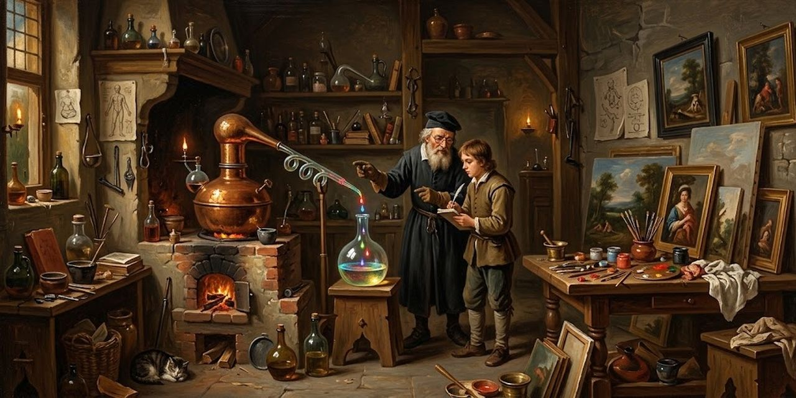

15 de octubre de 2026

# El protocolo de imagen Alambique



Un alambique es el aparato que destila: calienta una mezcla y recoge lo esencial, gota a gota. Este protocolo hace lo mismo con un texto: lo lee y lo destila en una imagen.

El sistema recibe un texto, de una frase a una página, y entrega una pintura al óleo. Decide solo, de principio a fin.

## Qué entra y qué sale

Entra un texto, en cualquier idioma. Sale una imagen apaisada de 2:1, de 1280 × 640 píxeles, en JPG al 80 %, pintada al estilo de un pintor famoso que el texto mismo elige.

## Los pasos

1. Leer el texto con atención total: su carga, su tensión, lo que pide ver.
2. Imaginar dos imágenes: una literal, que muestra la escena que el texto describe, y una simbólica, que encarna lo que el texto dice. Elegir una. La literal es la regla; la simbólica se elige cuando el texto no describe ninguna escena.
3. Elegir el pintor de la lista de más abajo: el de la descripción que más se parece al ambiente del texto, en luz, tensión y escala. Si dos encajan, se toma el menos usado en las últimas imágenes.
4. Ponerle a la imagen un título de 2 a 4 palabras, tomadas o inspiradas del texto.
5. Escribir el prompt en castellano, aunque el texto esté en otro idioma, con el molde de más abajo.
6. Generar la imagen en Gemini, con la cuenta de Osmancito. El cupo es de unas 15 imágenes por ventana de cinco horas.
7. Mirar la imagen entera antes de usarla: la escena pedida, manos y rostros bien formados, la etiqueta escrita tal cual y ningún otro texto. Si algo falla, se repite el prompt con la corrección, hasta tres intentos.
8. Guardar el resultado. Gemini entrega unos 1024 píxeles de ancho; se recorta a 2:1 desde el centro, se escala a 1280 × 640 y se guarda como JPG al 80 %.

## La proporción

Todas las imágenes salen en 2:1: las de las salas, las portadas, el og:image de las páginas y las publicaciones en redes. Un solo formato, con un margen de 40 puntos por lado donde no queda nada importante, de modo que cada sala y cada red puedan recortar sin perder lo esencial.

## Con etiqueta o sin ella

Las imágenes que viajan solas, como las publicaciones en redes, llevan una etiqueta discreta en la esquina inferior derecha: título, pintor y Osmancito, separados por un punto medio. Las que van arriba de una página no llevan etiqueta. Los títulos y las etiquetas de las imágenes que viajan a redes van en inglés.

## El molde del prompt

```
Óleo, sin fotorrealismo. [Escena en una o dos frases.] [Luz y ambiente.] Al estilo de [Pintor]: [descripción de la lista, completa]. Composición apaisada 2:1 con lo importante lejos de los bordes. [Con etiqueta: Etiqueta discreta en la esquina inferior derecha con exactamente este texto: Título · Pintor · Osmancito. Ningún otro texto.] [Sin etiqueta: Ningún texto, ninguna letra, ninguna etiqueta.]
```

## Un ejemplo

Texto: «De tanto calibrar la máquina para que ande sola, entendí que el mejor modo es otro: caminar con la máquina.» El texto describe un paseo y pide un paisaje vasto con figuras de espaldas y luz serena, así que la imagen es literal y el pintor es Caspar David Friedrich. Título: Caminar con la máquina. Prompt:

```
Óleo, sin fotorrealismo. Una joven y una máquina de latón de un solo ojo de lente caminan lado a lado, de espaldas, por una cresta sobre un mar de niebla al amanecer; ella apoya una mano en el hombro de la máquina; a lo lejos, cumbres y un territorio inmenso apenas dibujado. Luz trascendente, atmósfera vasta y serena. Al estilo de Caspar David Friedrich: Romanticismo, figuras de espaldas (Rückenfigur), paisajes vastos, niebla, luz trascendente. Composición apaisada 2:1 con lo importante lejos de los bordes. Etiqueta discreta en la esquina inferior derecha con exactamente este texto: Caminar con la máquina · Caspar David Friedrich · Osmancito. Ningún otro texto.
```

## La lista de pintores

Cada línea trae el pintor y su descripción visual, que se copia completa en el prompt.

- **Agnolo Bronzino**: Manierismo, colores saturados, superficies pulidas, iluminación suave, elegancia fría.
- **Albert Bierstadt**: Romanticismo, paisajes monumentales, luz dramática, atmósfera sublime, escala épica.
- **Albert Edelfelt**: Realismo nórdico, luz natural difusa, pincelada íntima, escenas costumbristas sensibles.
- **Alberto Durero**: Grabado renacentista, precisión lineal extrema, alto contraste, detalle minucioso, crosshatching.
- **Alfred Sisley**: Impresionismo, paisajes suaves, luz cambiante, pinceladas sueltas, paleta natural.
- **Amedeo Modigliani**: Modernismo, figuras alargadas, cuellos largos, rostros estilizados, colores terrosos.
- **Andrea Mantegna**: Renacimiento, perspectiva rigurosa, escorzos dramáticos, figuras escultóricas, iluminación dura.
- **Anthony van Dyck**: Barroco, retratos aristocráticos, pincelada fluida, telas suntuosas, elegancia dinámica.
- **Arnold Böcklin**: Simbolismo, atmósferas oníricas, misterio, paleta oscura, luz irreal y mitológica.
- **August Macke**: Expresionismo, colores vibrantes y puros, formas simplificadas, alegría visual, sin sombreado complejo.
- **Camille Pissarro**: Impresionismo, textura viva, luz difusa, pincelada comunal, escenas vibrantes.
- **Caravaggio**: Barroco, claroscuro extremo (tenebrismo), dramatismo teatral, realismo crudo, fondo oscuro.
- **Caspar David Friedrich**: Romanticismo, figuras de espaldas (Rückenfigur), paisajes vastos, niebla, luz trascendente.
- **Charles-François Daubigny**: Escuela de Barbizon, paisajes fluviales, naturalismo suave, paleta terrosa, atmósfera serena.
- **Childe Hassam**: Impresionismo americano, luz urbana luminosa, pincelada vibrante, escenas festivas, paleta clara.
- **Claude Monet**: Impresionismo, disolución de la forma, luz y color puro, pincelada rápida, atmósfera efímera.
- **Crowley/Harris (Thoth)**: Simbolismo esotérico, color simbólico intenso, geometría mística, líneas Art Déco, arquetipos.
- **David Teniers el Joven**: Barroco flamenco, escenas de género, detalle costumbrista, iluminación cálida de taberna.
- **Edgar Degas**: Impresionismo, composiciones asimétricas, perspectivas inusuales, captura de movimiento, luz artificial.
- **Édouard Manet**: Realismo, pinceladas directas y planas, contrastes fuertes, negros profundos, modernidad.
- **Edvard Munch**: Expresionismo, líneas ondulantes y distorsionadas, colores psicológicos, angustia visual.
- **Egon Schiele**: Expresionismo, líneas nerviosas y angulares, cuerpos crudos, contornos marcados, paleta terrosa.
- **El Greco**: Manierismo, figuras alargadas y flameantes, luz espiritual fría, colores ácidos, dramatismo místico.
- **Ernst Ludwig Kirchner**: Expresionismo, colores chillones y antinaturales, formas angulosas, tensión urbana, pincelada agresiva.
- **Eugène Boudin**: Precursor impresionismo, cielos amplios y nublados, playas, luz atmosférica suave, pincelada rápida.
- **Eugène Delacroix**: Romanticismo, movimiento dramático, pincelada vibrante, color intenso y rico, pasión visual.
- **Ferdinand Hodler**: Simbolismo, paralelismo compositivo, figuras rítmicas y repetitivas, solemnidad, líneas ondulantes.
- **Fra Angelico**: Renacimiento temprano, colores luminosos y pastel, perspectiva clara, serenidad, luz divina.
- **Francisco de Goya**: Romanticismo, pincelada suelta y oscura, contrastes dramáticos, atmósfera psicológica y cruda.
- **Frederic Edwin Church**: Romanticismo americano, paisajes épicos, luz dramática y detallada, atmósfera sublime.
- **Frederic Leighton**: Academicismo, idealización clásica, composición armónica, telas drapeadas, acabado pulido.
- **George Inness**: Tonalismo, atmósferas brumosas, tonos suaves y difuminados, quietud, luz espiritual suave.
- **George Stubbs**: Neoclasicismo, precisión anatómica extrema, naturalismo elegante, fondos paisajísticos serenos.
- **George Wesley Bellows**: Realismo americano, pinceladas vigorosas y espesas, energía cruda, contraste urbano.
- **Georges Seurat**: Puntillismo, composición mediante puntos de color (divisionismo), calma estructurada, geometría.
- **Gilbert Stuart**: Retrato colonial, acabado formal y sobrio, iluminación de estudio, precisión facial, paleta conservadora.
- **Canaletto**: Vedutismo, vistas urbanas precisas, luz clara y diáfana, perspectiva arquitectónica rigurosa.
- **Giovanni Bellini**: Renacimiento veneciano, luz suave y dorada, paisajes serenos, delicadeza en los rostros.
- **Gustav Klimt**: Simbolismo, ornamento dorado, patrones decorativos, sensualidad, mosaicos de color.
- **Gustave Caillebotte**: Impresionismo, perspectivas urbanas audaces (picado/contrapicado), precisión casi fotográfica.
- **Gustave Courbet**: Realismo, crudeza sin idealizar, textura densa (espátula), paleta terrosa, luz natural directa.
- **Gustave Doré**: Ilustración romántica, grabado en madera, claroscuro narrativo, épica, alto contraste blanco y negro.
- **Hans Holbein el Joven**: Renacimiento del norte, realismo frío, detalle textil minucioso, iluminación frontal y clara.
- **Hans Memling**: Renacimiento flamenco, detalle delicado, color suave y esmaltado, quietud contemplativa.
- **Hans Thoma**: Realismo romántico, paisajes idílicos, luz cálida y nostálgica, sencillez narrativa.
- **Hendrick Avercamp**: Barroco holandés, escenas invernales, paleta de grises y blancos, multitudes detalladas sobre hielo.
- **Henri Rousseau**: Naíf, naturaleza exuberante y selvática, perspectivas planas, ingenuidad deliberada, colores saturados.
- **Toulouse-Lautrec**: Post-impresionismo, líneas expresivas y rápidas, colores planos, vida nocturna, ángulos inusuales.
- **El Bosco**: Renacimiento del norte, fantasía simbólica densa, criaturas híbridas, paisajes oníricos, detalle microscópico.
- **Ivan Aivazovsky**: Romanticismo marino, mar dramático, translucidez del agua, luz sobre las olas, atmósfera tormentosa.
- **Jacob van Ruisdael**: Barroco holandés, paisajes atmosféricos, cielos protagónicos y nublados, melancolía natural.
- **Käthe Kollwitz**: Expresionismo social, grafito y grabado austero, alto contraste, líneas angustiosas, sombras profundas.

Osmancito, con la asistencia de Instinct
