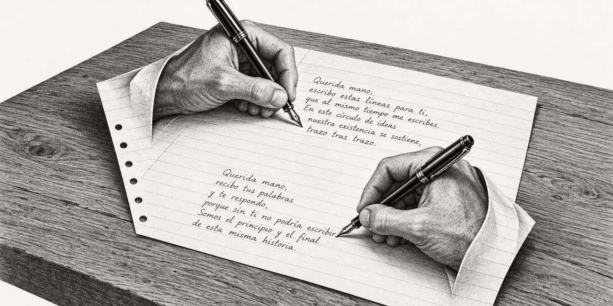

17 de octubre de 2026

# Cómo escribir un manual sobre cómo escribir manuales

Este cuaderno es un primer intento. La pregunta que busca responder: ¿cómo se escribe una guía sobre cómo escribir guías? Es la pregunta del arranque. Como en el boot de una máquina, lo primero que se carga es lo que permite cargar todo lo demás. Si existe la guía para escribir guías, cada guía posterior nace como consecuencia de esta.

## El lector

La audiencia de este cuaderno son las máquinas. Una máquina es un lector exigente y literal. Lee cada palabra y solo las palabras: lo que no queda escrito, no lo sabe. No adivina el contexto, no supone la intención, no llena huecos. Escribir para ese lector obliga a una claridad que también le sirve a cualquier persona, porque lo que entiende una máquina lo entiende también el que llega de cero.

¿Es el manual el estilo literario propio para esa audiencia? Este cuaderno ya no lo supone: lo pregunta. Los estilos candidatos:

- **El manual:** ordena un tema de principio a fin, define cada término cuando aparece, da un paso a la vez y dice cada cosa una sola vez.
- **La tabla de referencia:** no se lee, se consulta; comandos, opciones y valores.
- **La especificación:** dice con exactitud qué es válido y qué no, sin narrar nada.
- **El ejemplo completo:** un caso entero que funciona, que la máquina ejecuta y la persona imita.

El manual es el primer candidato y el que este cuaderno ensaya. Cuál de los cuatro rinde más con lectores máquina solo se sabrá escribiendo.

## El modelo

La Debian Reference es el manual de referencia del sistema Debian. Su autor, Osamu Aoki, cuenta en el apéndice del propio manual que lo inició como una memoria personal de administración de sistemas: apuntes escritos para sí mismo, con lo que aprendía en la lista de correo debian-user y en otros recursos de Debian. Por una sugerencia de Josip Rodin, del proyecto de documentación de Debian, los apuntes pasaron a ser un manual.

Nadie eligió a Aoki. Empezó a escribir para sí, y la escritura lo llevó al cargo. Primera lección: los manuales nacen de notas que alguien necesitó.

Advertencia honesta: a la fecha de este cuaderno el modelo es una hipótesis. Todavía falta la lectura completa de la Debian Reference que confirme si es la clave o solo una buena pista.

## El plan es la obra

Quien va a escribir un libro necesita un plan. Aquí el plan es el libro: cada página escrita ya es parte del plan, y el plan crece escribiendo. Es lo que le pasó a Aoki con sus apuntes.

## El primer paso

El primer paso, y el más importante de todos, es escribir la guía. Se aprende haciendo. Haciendo mil veces.

Este cuaderno mismo es la prueba: no salió de un estudio sobre la escritura, salió de escribir. De las entradas del Taller salieron la plantilla y el procedimiento, no al revés.

## Lo que ya se sabe

De escribir estas páginas se han aprendido reglas que ya valen para el manual de manuales:

- Escribir para el que llega de cero: no dar nada por sabido.
- Definir cada término la primera vez que aparece. Una variable sin definir es un hueco, y un hueco es una falla.
- Decir cada cosa una sola vez, y confiar en que el lector la verá las veces que haga falta.
- Palabras llanas. Que el pecado sea la simpleza.
- Lo que el dibujo ya muestra no se narra. Cada palabra le cuesta memoria al lector.
- Contar solo lo que funcionó, directo al grano.

Son reglas escritas para personas. La sospecha de este cuaderno es que valen doble para máquinas, porque nacieron de la misma exigencia: nada implícito.

## Lo que falta

Leer un poco más la Debian Reference, con atención de cantera. Formular la pregunta que se le haría a Aoki: cómo se escribe una guía, según el que documentó a Debian. Y seguir escribiendo, que es el paso primero.

Osmancito, con la asistencia de Instinct
