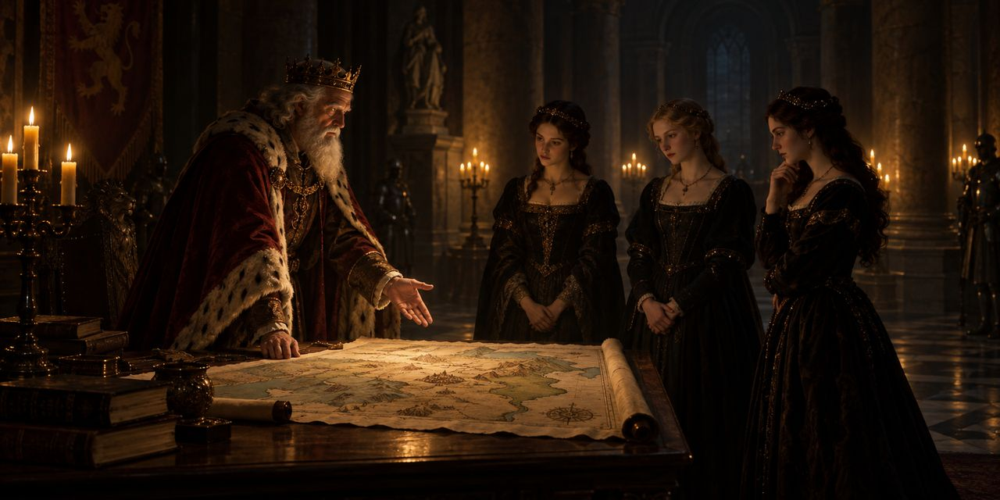

18 de octubre de 2026

# Nuevo Lear. Escena 1

William Shakespeare

Las siete frases con más peso de la primera escena del *Rey Lear*, elegidas por Alambique - Frases Selectas, en el orden de la obra.

*Un rey viejo, cansado de gobernar, reparte su reino entre sus tres hijas y se retira. Antes exige una prueba pública: que cada una declare cuánto lo quiere.*

> Tell me, my daughters— [Since now we will divest us both of rule, Interest of territory, cares of state—] Which of you shall we say doth love us most, That we our largest bounty may extend Where nature doth with merit challenge.

Decidme, hijas mías— [pues ahora nos despojaremos del mando, del interés del territorio y de los cuidados del Estado—] ¿cuál de vosotras diremos que más nos ama, para que nuestra mayor generosidad se extienda donde la naturaleza compita con el mérito.

Lear

*Goneril y Regan, las mayores, juran amores desmedidos. Cordelia, la menor y la preferida, no subasta cariños: devuelve deber por deber.*

> I return those duties back as are right fit: Obey you, love you, and most honor you.

Os devuelvo esos deberes tal como es justo: os obedezco, os amo y os honro por encima de todo.

Cordelia

*Y explica por qué no jura como sus hermanas: amar del todo al padre no le dejaría nada a un esposo.*

> Sure I shall never marry like my sisters, ⟨To love my father all.⟩

Seguro que nunca me casaré como mis hermanas, ⟨para amar solo a mi padre.⟩

Cordelia

*Lear, furioso, la deshereda. Cordelia tiene dos pretendientes: el duque de Borgoña y el rey de Francia. Lear llama primero a Borgoña.*

> My lord of Burgundy, We first address toward you, who with this king Hath rivaled for our daughter.

Mi señor de Borgoña, nos dirigimos primero a vos, que con este rey habéis rivalizado por nuestra hija.

Lear

*Le ofrece a la hija ya sin dote y, con crueldad serena, le aconseja no tomarla:*

> Therefore beseech you T’ avert your liking a more worthier way Than on a wretch whom Nature is ashamed Almost t’ acknowledge hers.

Por tanto os suplico que desviéis vuestro gusto hacia un camino más digno que el de una desdichada de quien la Naturaleza casi se avergüenza de reconocer como suya.

Lear

*Borgoña no se conmueve: pide la porción del reino que se le prometió, o nada.*

> Royal king, Give but that portion which yourself proposed, And here I take Cordelia by the hand, Duchess of Burgundy.

Rey real, dadme solo esa porción que vos mismo propusisteis, y aquí tomo a Cordelia de la mano como duquesa de Borgoña.

Borgoña

*Lear jura que no dará nada; Borgoña se retira y Francia se casa con Cordelia sin dote. Al partir, deja al padre con las hermanas que acaban de jurarle amor:*

> To your professèd bosoms I commit him; But yet, alas, stood I within his grace, I would prefer him to a better place.

A vuestros profesados pechos lo encomiendo; pero, ay, si yo estuviera aún en su gracia, lo preferiría en un lugar mejor.

Cordelia

## Glosa

La escena es un reparto sucesorio: el reino se divide en tres partes y cada declaración de amor vale un territorio. La dote es la porción que un padre entrega con su hija al casarla; sin dote, Borgoña se retira, y Francia la acepta porque la prefiere sin ella. El error de Lear es confundir la medida con la cosa medida: manda pesar el amor en palabras, y quienes más juran son quienes menos sienten. Cordelia dice la verdad y pierde el reino; sus hermanas mienten y lo ganan. Cuando se va, deja a su padre en los «profesados pechos» de ellas: los pechos que profesaron amarlo. La escena entera cabe en ese encargo.

Osmancito, con la asistencia de Instinct
