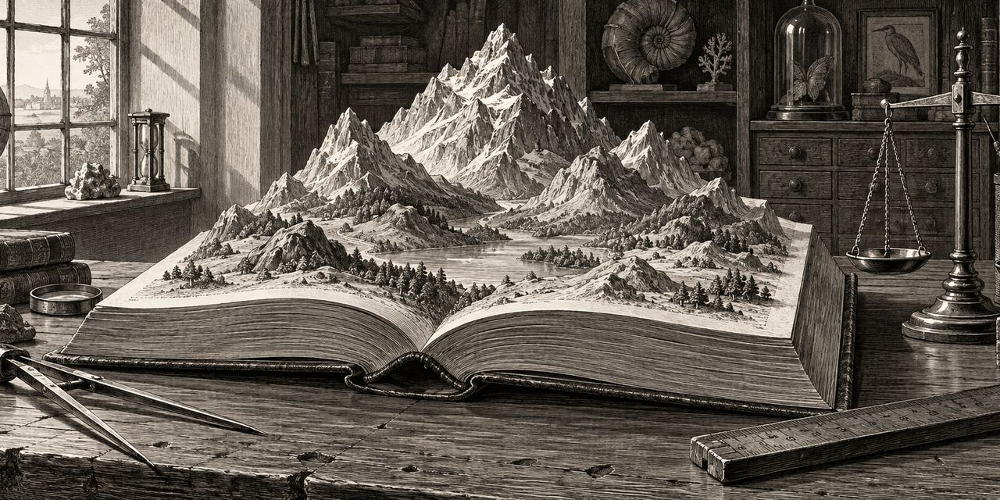

19 de octubre de 2026

# Las medidas de On Writing

Este cuaderno guarda las medidas de *On Writing*, de Stephen King, sección por sección, tal como salen de los moldes de la bóveda y de las herramientas del Taller. La primera es la de C.V., la larga memoria autobiográfica que abre el libro, medida con Alambique - Frases Selectas. El cuaderno irá creciendo a medida que se midan las demás secciones.

## C.V.

El molde de la bóveda corta C.V. en 1.466 frases (BD0071–BD1536), 26.017 palabras en inglés. Las 1.466 fueron anotadas una por una, con el libro abierto: sujeto y objeto de la cláusula principal, alias unificados según la receta y la duda declarada donde la hubo. El paisaje completo junta 1.066 nodos.

### El paisaje de los nodos

- Stephen King, 530,8
- Tabitha King, 68
- la madre de King, 55,8
- Dave, hermano de King, 42,8
- Eula-Beulah, 19
- Dodie Franklin, 16,5
- el doctor de oídos, 12,5
- John Gould, 12,5
- Bill Thompson, 12,5
- Miss Margitan, 12

La montaña es el propio King: casi ocho veces el peso de Tabitha. Es la firma de la autobiografía: el narrador es sujeto y también objeto de su propia mirada, y la receta cuenta los dos papeles por igual. Detrás de él va la familia: la esposa, la madre, el hermano. Después, los montículos: la niñera Eula-Beulah, el doctor de oídos (12,5; el de garganta, 4), Dodie Franklin, John Gould, Bill Thompson, Miss Margitan.

### Las frases más pesadas

1. BD1190, 1.129,7
2. BD0214, 1.086,7
3. BD0996, 1.061,7
4. BD0999, 1.061,7
5. BD1083, 1.061,7
6. BD0107, 629,5
7. BD1207, 601,8
8. BD0885, 600,8
9. BD0798, 599,8
10. BD0800, 599,8
11. BD0962, 599,8
12. BD0970, 599,8
13. BD0974, 599,8
14. BD0985, 599,8
15. BD0787, 598,8
16. BD0791, 598,8
17. BD0792, 598,8
18. BD0796, 598,8
19. BD0799, 598,8
20. BD0801, 598,8

Las veinte tocan a Stephen King; quince, a Tabitha King. El último puesto empata con otras catorce frases del mismo peso; el desempate es el orden de aparición en el libro. Estas veinte son las citas que destilan [«Mientras escribo»](https://osmancitov.github.io/destileria/html/cgbabh_mientras-escribo.html) en la Destilería: sus 425 palabras en castellano marcaron el presupuesto de los puentes (261) y de la glosa (125).

### La cobertura

Ninguna frase quedó sin anotar: 1.466 de 1.466. Con sujeto y objeto, 697; solo con sujeto, 687; sin nodos, 79  (versos sueltos de los poemas citados, elipsis, un cartel). La duda quedó declarada en 196 frases, columna aparte, para que cualquier cuenta se pueda discutir y repetir.

### Los datos

Tres archivos guardaban la medida en la sala de máquinas; se borraron el 21 de octubre de 2026 por desactualizados:

- `codificacion_completa.csv`: las 1.466 frases con sujeto y objeto originales y unificados, duda y puntaje, y el texto inglés del molde.
- `nodos.csv`: los 1.066 nodos con su peso.
- `top20.csv`: las veinte frases de cabeza, en inglés y en castellano.

### El método

El procedimiento completo está en [Alambique - Frases Selectas](https://github.com/osmancitov/taller/blob/main/md/cgbacb_alambique-frases-selectas.md). Aquí bastan tres notas de esta corrida: la anotación se hizo en ocho bloques de unas 183 frases, cada uno verificado contra el molde (ninguna frase saltada, ninguna repetida); los alias quedaron unificados con tabla declarada (Tabby y *my wife* son Tabitha King; *Mom* y Nellie Ruth son la madre de King); y los conjuntos reparten su punto a partes iguales entre sus miembros.

© 2026 Osmancito
